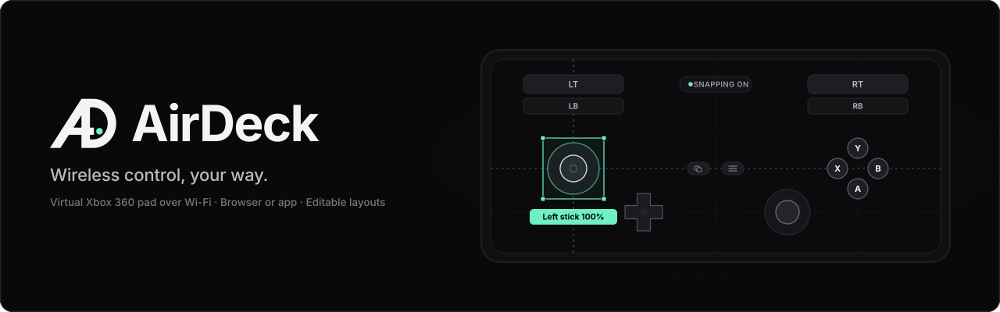

# AirDeck-PC

The Windows server for AirDeck. Use your phone as a PC game controller: it creates a virtual Xbox 360 gamepad from an Android phone or iPhone over Wi-Fi, and hosts a browser controller that needs no app.

[Download](https://github.com/horse-3903/AirDeck-PC/releases) | [Try it in your browser](https://horse-3903.github.io/demos/airdeck-demo.html) | [AirDeck docs](https://github.com/horse-3903/AirDeck) | [Android app](https://github.com/horse-3903/AirDeck-Mobile)

---

## Why AirDeck

Run this server on your Windows PC, connect a phone, and your games see a normal Xbox controller. Up to eight phones can join at once.

- **A real Xbox 360 controller** - through the ViGEm driver, or Windows InputInjector, or keyboard and mouse with keymap profiles.
- **App or browser** - the Android app, or any phone browser with the same layout editor and settings.
- **Game rumble, tilt steering, response curves** - tuned per layout.
- **Easy to join** - QR codes for the app and the browser, a ranked adapter list, and a live input test.

The full feature list, layouts and troubleshooting are in the [AirDeck docs](https://github.com/horse-3903/AirDeck).

---

## Quick start

1. Install the [ViGEmBus](https://github.com/nefarius/ViGEmBus/releases) driver once.
2. Download the zip from [Releases](https://github.com/horse-3903/AirDeck-PC/releases), unzip it and run `AirDeck.exe`.
3. Press Start, open Connect device, and scan a QR code with your phone.

Requires Windows 10 or later, 64-bit. The phone and PC need to share a network.

---

## Documentation

| Page | What is in it |
|---|---|
| [Development](docs/development.md) | Build, run, settings and releasing |
| [Architecture](docs/architecture.md) | How the server, executors and browser controller fit together |
| [Protocol](https://github.com/horse-3903/AirDeck/blob/main/docs/protocol.md) | The wire format for the app and the browser |
| [User docs](https://github.com/horse-3903/AirDeck/blob/main/docs/README.md) | Getting started, features, layouts and troubleshooting |
| [Roadmap](ROADMAP.md) | What is planned next |

---

## Support and contributing

Report bugs and ideas in the [AirDeck repo](https://github.com/horse-3903/AirDeck/issues). Pull requests for the server go here: [docs/development.md](docs/development.md) covers building and the project layout. Each [release](https://github.com/horse-3903/AirDeck-PC/releases) lists what changed.

---

## Credits and licence

Built on [VirtualGamePad](https://kitswas.github.io/VirtualGamePad/) by [kitswas](https://github.com/kitswas). Released under the GNU General Public License v3.0, see [LICENCE.TXT](LICENCE.TXT).
